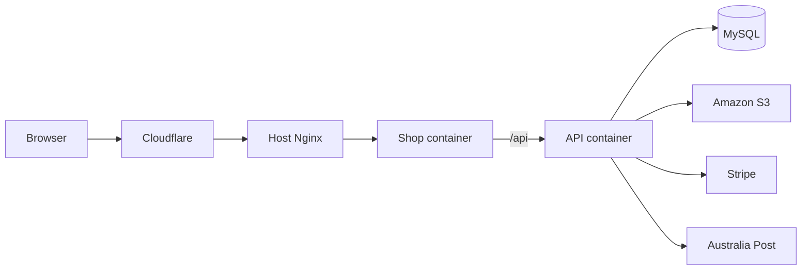
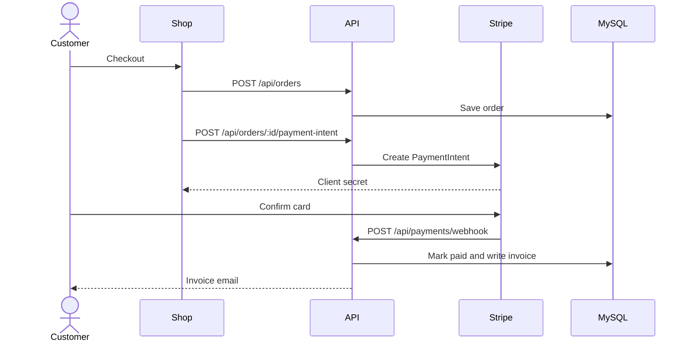

# Badminton Stores

A full-stack badminton shop: catalog, cart, checkout, invoices, and an admin console. The live site is [badmintonecommerce.store](https://badmintonecommerce.store).

The browser is a React SPA. The API is Express and TypeScript. Data lives in MySQL. Photos and videos live in Amazon S3. Card payments go through Stripe, and domestic shipping quotes go through Australia Post.

Sign-in uses HTTP-only cookies. Sample accounts are on the sign-in page:

| Role | Email | Password |
| --- | --- | --- |
| Admin | adminuser@gmail.com | `123456!` |
| Customer | alice.johnson@gmail.com | `123456` |

## Architecture



The shop and the API share one origin. The browser calls `/api` on the same host, so cookies stay first-party. Host Nginx terminates HTTPS and proxies the domain to the shop container. Nginx inside that container serves the SPA and forwards `/api/` to the API on the Docker network. The API port is not published on the host.



## Stack

| Layer | Choice |
| --- | --- |
| Shop | React 18, Vite, Tailwind CSS, Axios, Recharts |
| API | Node.js, Express, TypeScript, mysql2 |
| Auth | JWT access and refresh tokens in HTTP-only cookies |
| Payments | Stripe PaymentIntents and webhooks |
| Media | Multer, Sharp, Amazon S3 |
| Documents | PDFKit invoices, Nodemailer |
| Shipping | Australia Post PAC domestic quote |
| Production | Docker Compose, Nginx, Cloudflare, Contabo VPS |

## Repository

```text
frontend/     React shop and admin UI
backend/      Express API, SQL schema, Docker image
shared/       Types used by both apps
scripts/      Production start script used on the VPS
```

## Shop pages

| Path | Who | Page |
| --- | --- | --- |
| `/` | Public | Home |
| `/products`, `/products/:id` | Public | Catalog and product |
| `/clearance` | Public | Clearance |
| `/cart` | Public | Cart, including a guest cart |
| `/login`, `/register` | Public | Sign in and register |
| `/forgot-password`, `/reset-password/:token` | Public | Password reset |
| `/checkout` | Customer | Checkout |
| `/orders`, `/orders/:id` | Customer | Order history |
| `/invoices`, `/invoices/:id` | Customer | Invoices |
| `/profile` | Customer | Profile and addresses |
| `/admin/dashboard` | Admin | Sales, orders, and inventory |
| `/admin/products`, `/admin/orders`, `/admin/users` | Admin | Catalog, orders, and accounts |
| `/admin/categories`, `/admin/subcategories`, `/admin/child-categories` | Admin | Category tree |
| `/admin/vouchers`, `/admin/reviews`, `/admin/comments` | Admin | Promotions and moderation |
| `/admin/invoices`, `/admin/carts`, `/admin/product-views` | Admin | Invoices, carts, and views |
| `/admin/images`, `/admin/videos` | Admin | Media library |

Unknown paths render a 404 page. A render error is caught by the error boundary.

## API

The base URL in local development is `http://localhost:5000`. In production the same paths are called as `/api/...` on the shop host.

Cookies are sent with `credentials`. Access is one of:

- **Public** — no session required
- **Optional** — a session is used when the cookie is present
- **Customer** — a signed-in user
- **Admin** — a signed-in user with the admin role

`GET /api/health` is public and returns `{ "status": "OK" }`.

### Auth

| Method | Path | Access | Purpose |
| --- | --- | --- | --- |
| POST | `/api/auth/register` | Public | Create an account |
| POST | `/api/auth/login` | Public | Set access and refresh cookies |
| POST | `/api/auth/logout` | Customer | Clear the session |
| POST | `/api/auth/refresh` | Public | Rotate the access cookie |
| POST | `/api/auth/session-check` | Customer | Read the current session. POST avoids a cached logged-out response. GET remains for older clients. |
| GET | `/api/auth/me` | Optional | Current user, if signed in |
| GET | `/api/auth/profile` | Customer | Profile |
| PUT | `/api/auth/profile` | Customer | Update profile |
| POST | `/api/auth/forgot-password` | Public | Send a reset email |
| POST | `/api/auth/reset-password` | Public | Set a new password from the token |
| GET | `/api/auth/addresses` | Customer | List addresses |
| POST | `/api/auth/addresses` | Customer | Add an address |
| PUT | `/api/auth/addresses/:id` | Customer | Update an address |
| DELETE | `/api/auth/addresses/:id` | Customer | Delete an address |

### Catalog, cart, and discovery

| Method | Path | Access | Purpose |
| --- | --- | --- | --- |
| GET | `/api/products` | Public | List and filter products |
| GET | `/api/products/clearance` | Public | Clearance products |
| GET | `/api/products/categories` | Public | Categories |
| GET | `/api/products/subcategories` | Public | Subcategories |
| GET | `/api/products/subcategories/:categoryId` | Public | Subcategories in a category |
| GET | `/api/products/child-categories/:subcategoryId` | Public | Child categories |
| GET | `/api/products/child-category/:id` | Public | One child category |
| GET | `/api/products/:id` | Optional | Product detail. Records a view |
| GET | `/api/products/:productId/reviews` | Public | Reviews |
| GET | `/api/products/:productId/reviews/my` | Customer | The signed-in user's review |
| GET | `/api/products/:productId/reviews/eligibility` | Customer | Whether the user can review |
| POST | `/api/products/:productId/reviews` | Customer | Write a review |
| PUT | `/api/reviews/:id` | Customer | Edit a review |
| DELETE | `/api/reviews/:id` | Customer | Delete a review |
| GET | `/api/products/:productId/comments` | Public | Comments |
| GET | `/api/products/:productId/comments/my` | Customer | The user's comments |
| POST | `/api/products/:productId/comments` | Customer | Add a comment |
| PUT | `/api/comments/:id` | Customer | Edit a comment |
| DELETE | `/api/comments/:id` | Customer | Delete a comment |
| POST | `/api/products/:productId/like` | Customer | Toggle a like |
| GET | `/api/products/:productId/likes` | Public | Like count |
| GET | `/api/products/:productId/liked` | Customer | Whether the user liked it |
| GET | `/api/users/liked-products` | Customer | Products the user liked |
| GET | `/api/cart` | Optional | Guest or user cart |
| POST | `/api/cart` | Optional | Add an item |
| PUT | `/api/cart/:itemId` | Optional | Change quantity |
| DELETE | `/api/cart/:itemId` | Optional | Remove an item |
| DELETE | `/api/cart` | Optional | Empty the cart |
| POST | `/api/cart/transfer` | Customer | Move a guest cart onto the account |
| POST | `/api/product-views` | Optional | Record a product view |
| GET | `/api/product-views/recent` | Optional | Recently viewed |
| DELETE | `/api/product-views/recent` | Optional | Clear recent views |
| GET | `/api/product-views/recommendations` | Optional | Recommendations |
| GET | `/api/product-views/recommendations/:productId` | Optional | Related products |
| GET | `/api/vouchers` | Public | Active vouchers |
| GET | `/api/vouchers/:id` | Public | One voucher |
| POST | `/api/vouchers/validate` | Customer | Check a code against an order total |

### Checkout

| Method | Path | Access | Purpose |
| --- | --- | --- | --- |
| POST | `/api/shipping/quote` | Customer | Australia Post domestic quote |
| POST | `/api/orders` | Customer | Place an order |
| GET | `/api/orders` | Customer | The user's orders |
| GET | `/api/orders/:id` | Customer | One order |
| POST | `/api/orders/:id/payment-intent` | Customer | Stripe PaymentIntent |
| PUT | `/api/orders/:id/pay` | Customer | Record a payment update |
| GET | `/api/payments/config` | Public | Stripe publishable key |
| POST | `/api/payments/webhook` | Stripe | `payment_intent.succeeded`, `payment_failed`, and `canceled` |
| GET | `/api/invoices` | Customer | The user's invoices |
| GET | `/api/invoices/:id` | Customer | One invoice |
| GET | `/api/invoices/:id/download` | Customer | PDF download |

### Admin

Every path below is under `/api/admin` and requires an admin session.

| Resource | Methods |
| --- | --- |
| `/stats`, `/stats/overview`, `/stats/sales`, `/stats/orders` | GET |
| `/stats/customers`, `/stats/inventory`, `/stats/revenue-chart` | GET |
| `/stats/revenue-by-category`, `/stats/top-products` | GET |
| `/stats/recent-activity`, `/stats/performance` | GET |
| `/users`, `/users/:id` | GET, PUT, DELETE |
| `/users/quick-create` | POST |
| `/users/:id/role`, `/users/:id/status` | PUT |
| `/users/bulk-update` | POST |
| `/products`, `/products/:id` | GET, DELETE |
| `/products/quick-create` | POST |
| `/products/:id/stock`, `/products/:id/status`, `/products/:id/price` | PUT |
| `/products/:id/out-of-stock` | PUT |
| `/products/bulk-update`, `/products/bulk-delete`, `/products/bulk-stock-update` | POST |
| `/orders`, `/orders/:id`, `/orders/items`, `/orders/items/:id` | GET |
| `/orders/:id`, `/orders/items/:id` | PUT |
| `/orders/:id` | DELETE |
| `/orders/bulk-update`, `/orders/bulk-delete` | POST |
| `/invoices`, `/invoices/:id` | GET, PUT, DELETE |
| `/invoices/:id/resend-email` | POST |
| `/invoices/bulk-delete` | POST |
| `/reviews`, `/reviews/:id` | GET, PUT, DELETE |
| `/reviews/:id/approve`, `/reviews/:id/reject` | PUT |
| `/reviews/bulk-approve` | POST |
| `/comments`, `/comments/:id` | GET, DELETE |
| `/comments/bulk-approve` | POST |
| `/vouchers/quick-create` | POST |
| `/vouchers/:id/status` | PUT |
| `/product-views` | GET |
| `/product-views/:id` | DELETE |
| `/product-views/bulk-delete` | POST |
| `/categories`, `/subcategories`, `/child-categories` | GET, POST |
| `/categories/:id`, `/subcategories/:id`, `/child-categories/:id` | PUT, DELETE |
| `/categories/:id/photo`, `/subcategories/:id/photo` | POST, DELETE |
| `/categories/bulk-delete`, `/subcategories/bulk-delete`, `/child-categories/bulk-delete` | POST |
| `/carts`, `/carts/:id`, `/carts/:id/items` | GET |
| `/carts/:id` | DELETE |
| `/carts/bulk-delete` | POST |
| `/images`, `/videos` | GET |
| `/products/:productId/media` | GET |
| `/products/:productId/media/bulk` | DELETE |
| `/bulk/delete` | POST |

Catalog writes also exist on the shop API for an admin session: `POST /api/products`, `PUT /api/products/:id`, `DELETE /api/products/:id`, plus image and video upload on `/api/products/:id/images` and `/api/products/:id/videos`. Voucher create, update, and delete are `POST /api/vouchers`, `PUT /api/vouchers/:id`, and `DELETE /api/vouchers/:id`.

## Run it locally

You need Node.js 18 or newer, npm, and MySQL.

```bash
npm run install:all
cp backend/.env.sample backend/.env
cp frontend/.env.sample frontend/.env
```

There is no `.env` at the repository root. Fill `backend/.env` from the sample: database, JWT, cookies, email, S3, Stripe, and Australia Post. Leave secrets empty until you have them. Create the tables with `backend/database/schema.sql`.

For local HTTP, set `NODE_ENV=development`, `COOKIE_SECURE=false`, and `COOKIE_SAMESITE=Lax`. Leave `VITE_API_URL` empty. Vite proxies `/api` to `http://localhost:5000`. Set `VITE_STRIPE_PUBLISHABLE_KEY` if checkout should use a key baked into the shop. The API can also return one from `GET /api/payments/config`.

```bash
npm run dev
```

| App | URL |
| --- | --- |
| Shop | http://localhost:3000 |
| API | http://localhost:5000 |
| Health | http://localhost:5000/api/health |

```bash
npm run typecheck
npm run build
```

`npm run build` compiles the API to `backend/dist` and the shop to `frontend/dist`. `npm start` runs the compiled API. `cd frontend && npm run lint` checks the remaining JavaScript files. TypeScript is covered by `npm run typecheck`.

A production shop build turns on the showcase-hours gate unless `VITE_SHOWCASE_HOURS_ENABLED=false`.

## Production

`main` and `dev` are for code. `prod` is the branch the VPS runs. Publish by merging both into `prod` and pushing:

```bash
git checkout prod
git merge main
git merge dev
git push origin prod
```

That push starts the Deploy production GitHub Action. It copies this repository to `/opt/projects/ecommerce_mysql_db` and runs `docker compose up -d --build` there. It does not change other projects on the server.

On `prod`, the shop container listens on `127.0.0.1:3010` only. Host Nginx proxies `badmintonecommerce.store` to that port. `backend/.env` and `frontend/.env` stay on the server and are not replaced by a deploy. `VITE_API_URL` stays empty. `FRONTEND_URL` is `https://badmintonecommerce.store`, and `https://www.badmintonecommerce.store` is allowed by CORS.

The action uses `VPS_HOST`, `VPS_USER`, and `VPS_SSH_KEY` from GitHub Actions secrets.

`docker compose up -d --build` in a local checkout of the other branches publishes the shop on port 3000 and the API on port 5000. Compose reads `backend/.env`. The frontend image reads `frontend/.env` while it builds, so `VITE_` values are baked in.

```bash
docker compose up -d --build
docker compose ps
docker compose logs --tail 100
docker compose stop
```

## Media

Set `USE_AWS_S3=true` and provide `AWS_REGION`, `AWS_ACCESS_KEY_ID`, `AWS_SECRET_ACCESS_KEY`, and `AWS_S3_BUCKET_NAME`. `AWS_S3_BUCKET_URL` is optional. When it is empty, the API builds the object URL from the bucket and region.

Uploads go through the API. The browser does not upload straight to the bucket. Product photos use normal image tags, and list images load lazily. The bucket must allow public `GetObject`, or the shop shows the placeholder. Image tags do not need bucket CORS. If another origin reads objects from JavaScript, allow `GET` and `HEAD` for that origin.

## License

ISC. Built by [Thang Truong](https://github.com/thangtruong1808).
